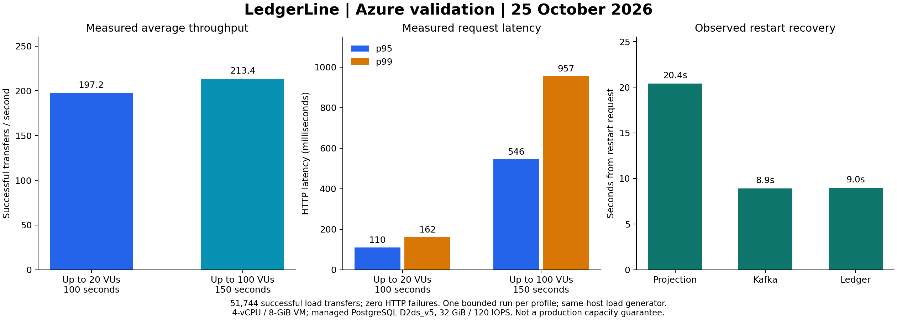

# Azure Boot 4 validation — 25 October 2026

The third acceptance attempt passed both unchanged load profiles, live API checks, full financial/projection assertions, interruption recovery, duplicate-event handling and a logical backup/restore test. Raw receipts and the synthetic database backup are retained privately; the [sanitized measurements](evidence/azure-boot4-2026-10-25.json) contain no tokens, credentials or account identifiers.



## Measured load results

| Existing profile | Duration | Peak configured VUs | Successful transfers | Average transfers/s | p95 | p99 | HTTP failures |
|---|---:|---:|---:|---:|---:|---:|---:|
| Correctness | 100 s | 20 | 19,726 | 197.24 | 110.32 ms | 161.51 ms | 0 |
| Performance | 150 s | 100 | 32,018 | 213.44 | 545.56 ms | 957.21 ms | 0 |

Both original threshold sets passed. The performance thresholds remain p95 < 750 ms, p99 < 1,500 ms and HTTP failure rate < 1%. The 51,744 total transfers are load-test HTTP 201 responses, excluding funding, API probes and recovery transactions. Rates are averages over ramp-up, steady and ramp-down stages; 100 VUs is the peak, not a claim of 100 continuously in-flight requests. Both profiles use the original randomized, two-account workload. No benchmark source, monetary fixture or expected-balance assertion was relaxed.

The projection is asynchronous. After each profile the observer required zero unpublished outbox events and matching ledger/projection counts within a 180-second deadline, then executed the full-history financial and projection assertions. This does not claim zero projection lag during load.

## Recovery and data verification

- Projection stopped: 20 transfers succeeded; health and projection catch-up were observed 20.422 seconds after the restart request.
- Kafka stopped: 20 transfers succeeded and 20 durable outbox events were observed; backlog and projection convergence completed 8.892 seconds after restart.
- Ledger restart: health and original-transaction replay were verified in 8.980 seconds; posting count was unchanged by replay.
- Duplicate Kafka event: the consumer's committed offsets advanced to the new log end while statement rows and processed-event count remained unchanged.
- Logical backup/restore: both application writers were stopped; a PostgreSQL 16 custom-format dump was restored into a separate database on the same managed server. All 11 application/migration table count/content fingerprints matched. The source contained 103,578 ledger postings. Dump command time was 8.962 seconds, restore command time 4.578 seconds, and the dump was 15,110,269 bytes. These command timings exclude quiescing, image download, fingerprint comparison and final validation; they are not disaster-recovery RTO or RPO commitments.

After services restarted, final SQL verified 103,578 ledger rows == 103,578 projection rows, zero global posting sum, no negative customer balances, no cached balance mismatches, no unbalanced transactions, and zero statement/daily-summary drift. The on-host API acceptance probe passed 22 HTTP checks, including projection polling; this is not 22 distinct unit-test cases.

## Exact environment and provenance

- Region: Central India. Regional Ubuntu 22.04 VM `Standard_D4ls_v6`, 4 vCPUs / 8 GiB RAM.
- Managed PostgreSQL 16: `Standard_D2ds_v5` General Purpose, 32 GiB Premium P4 storage, 120 provisioned IOPS.
- Container allocations: ledger 1.75 CPUs / 2 GiB; projection 0.75 CPUs / 1,400 MiB; Kafka 0.75 CPUs / 900 MiB. Kafka 3.8.0 is one self-hosted broker with three topic partitions.
- k6 runs in a separate 0.5-CPU container on the same VM, using host networking. This removes the laptop/WAN tunnel from measured request latency, but it is not an independent load-generator machine. No production capacity, high availability, long-term SLO or WAN latency guarantee is established.
- Application sources remain unchanged from `02ae50196ea21256bae1173fbd65494d5dc7167e`; image-build snapshot `7e68624bb3a683e261152142a7b3830c7c2a94fe` also includes the acceptance runner. The workload and executed probe hashes, image ID and raw receipt hashes are in the sanitized JSON.
- Java 21, Spring Boot 4.0.9 / Spring Framework 7.0.10. Both exact uploaded images passed Trivy 0.74.0 with zero findings under the configured HIGH/CRITICAL, fixed-vulnerability filter and zero applicability exceptions. This is not an all-severity or unfixed-vulnerability absence claim.
- HTTP service ports bind to VM localhost; SSH is restricted to the reviewer IP, and PostgreSQL firewall access is limited to reviewer/VM addresses. This is a temporary synthetic-money demonstration.

## Earlier attempts and limits

The first attempt passed the tunnel-based correctness workload (10,107 successful requests, two local Docker host connection timeouts), API checks and SQL. Its on-host performance attempt crossed a latency threshold, then Linux k6 export permissions and terminating Windows native-stderr handling prevented receipt collection before cleanup. It is not counted as a passing performance run. Both harness issues were reproduced/fixed, and actual Linux k6 summary export was rechecked.

The second attempt did not complete the laptop-tunnel health gate. Its retained combined Azure diagnostic output was truncated to approximately 4 KiB; cloud startup progressed to projection/Kafka group join, but that is not a completed acceptance result. The final attempt ran health, API and load checks inside Azure and launched recovery independently of the laptop SSH session. All earlier failed attempts remain separately recorded, with cleanup confirmed for their resource groups.

There is one completed run per load profile. Different hardware, cold/warm state, network paths and incomplete earlier measurements prevent a defensible percentage-improvement claim. These are measured results for the stated setup, not a sustained-production banking claim.

## Reproduce

```powershell
powershell -NoProfile -ExecutionPolicy Bypass -File scripts/azure-evidence-run.ps1 -VmSize Standard_D4ls_v6 -PostgresSku Standard_D2ds_v5 -PostgresTier GeneralPurpose -LedgerMemory 2g -LedgerCpu 1.75 -ProjectionMemory 1400m -ProjectionCpu 0.75 -RecoveryChecks -RemoteOnly -BudgetAmount 9500 -EvidenceDirectory <private-output-directory>
```

Requires an authorized Azure subscription, Docker, Azure CLI and SSH/SCP. It provisions paid, disposable resources and deletes its own resource group in `finally`; it does not modify existing resource groups. The budget object is a cost-tracking budget, not a hard charge cap. Review the current provider pricing and subscription spending limit before a new run. The backup/restore probe must only target the runner's disposable host/database.

Cleanup: Confirmed: the temporary resource group and its resources were deleted. This is not a continuously hosted demo.
